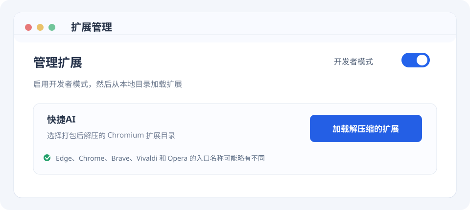
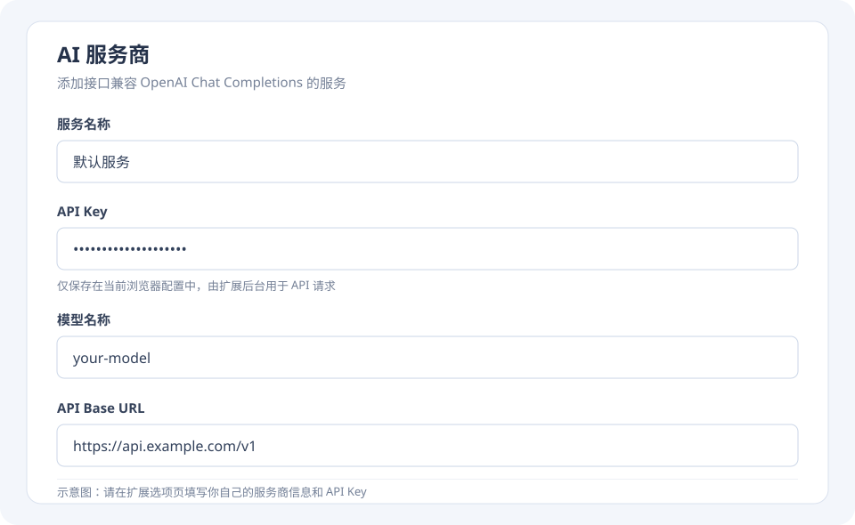
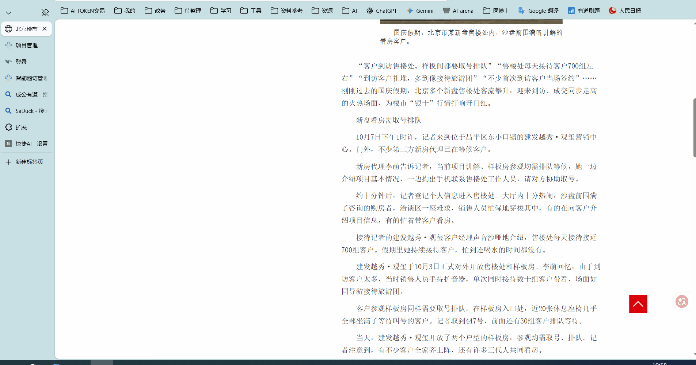
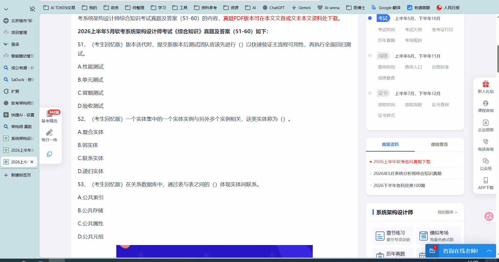
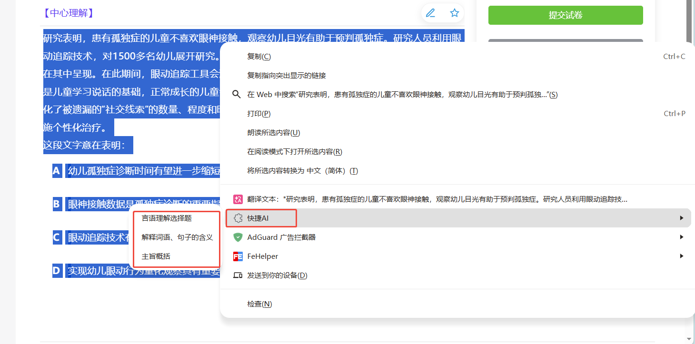
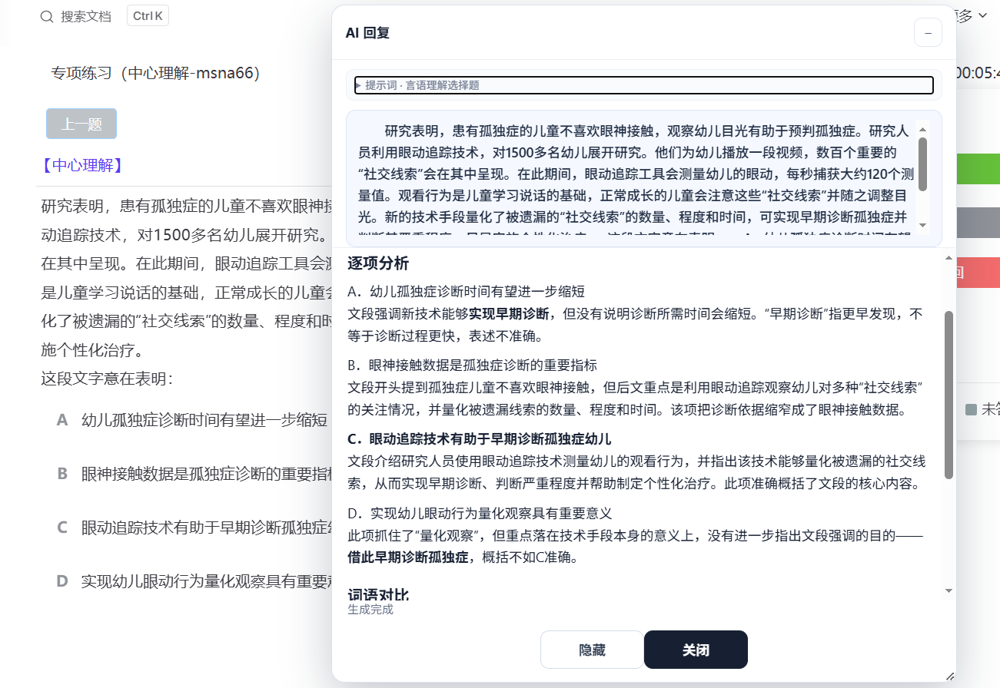

# 快捷AI

快捷AI 是一款 Manifest V3 浏览器扩展：选中网页文字后，从右键菜单选择提示词，将选中文字发送给你配置的 AI 服务商，并在网页中查看流式 Markdown 回复。

支持 Chromium 121+ 桌面版，包括 Edge、Chrome、Brave、Vivaldi 和 Opera。项目不依赖 npm 第三方包。

## 下载与安装

发布包会放在 [GitHub Releases](https://github.com/WenJiahu001/quick-ai/releases)。下载并解压 `quick-ai-chromium-v版本号.zip`。

### Edge、Chrome、Brave、Vivaldi 和 Opera

1. 解压 Chromium ZIP。
2. 打开扩展管理页：Edge 使用 `edge://extensions`，Chrome 使用 `chrome://extensions`，Brave 使用 `brave://extensions`，Vivaldi 使用 `vivaldi://extensions`，Opera 使用 `opera://extensions`。
3. 开启开发人员模式，选择“加载解压缩的扩展”，并选中解压后的目录。
4. 打开快捷AI选项页，配置 AI 服务商。

此安装方式通过浏览器开发者模式加载，不是 Chrome Web Store 或 Edge Add-ons 商店安装。



### 从源码构建

需要安装 Node.js。运行下列命令生成 Chromium 扩展目录：

```sh
node scripts/package.mjs
```

生成目录为 `dist/chromium/`。维护者可在 Windows PowerShell 中运行 `scripts/create-release-assets.ps1` 生成 Chromium 发布 ZIP。

修改源码后重新构建，在浏览器扩展管理页重新加载，并刷新已打开的网页。

## 配置

在选项页添加或选择 AI 服务商，填写服务商名称、API Key、模型名称和 API Base URL，然后保存。保存时浏览器会请求访问该 Base URL 对应站点的权限。更换服务商后，新请求使用当前选中的配置。

快捷AI 使用 OpenAI 兼容的 Chat Completions 接口（`/chat/completions`），要求服务商支持 Bearer Key 认证、Chat Completions 消息格式和 SSE 流式响应。默认模型为 `gpt-6-luna`，默认地址为 `https://api.openai.com/v1`。原生 Anthropic、Gemini 等非兼容协议暂不支持。Base URL 可使用 HTTP 或 HTTPS；HTTP 会明文传输 API Key 和请求内容，只应连接可信的本机或内网服务。



提示词可以添加、编辑、复制、排序、设为常用或禁用；禁用项不会出现在右键菜单中。清理规则按列表顺序进行区分大小写的字面匹配，可删除匹配文字，或替换为空格、换行及自定义内容。没有配置清理规则时，选中文字保持原样。

设置页支持导入或导出 JSON 配置备份。导出文件包含提示词、清理规则和服务商配置，但不包含 API Key。不同浏览器的扩展存储相互独立；迁移到另一个浏览器后，需要重新填写 API Key。

## 使用

1. 在普通网页中选中要提问的文字。
2. 右键打开“快捷AI”菜单。
3. 选择提示词，等待回复浮层显示流式结果。
4. 回复完成后，可在下方输入框继续追问；按 Enter 发送，按 Shift+Enter 换行。浮层按顺序保留本次对话，AI 会参考完整上下文。
5. 修改已发送的追问时，点击该条旁边的编辑图标，修改后选择“修改并重新生成”。编辑较早一轮会清除其后的追问和回复，并从修改后的内容继续对话。

点击浏览器工具栏中的快捷AI图标，可直接打开设置页面。

下面的动图展示了从选中文字、选择提示词到查看 AI 回复的使用效果：







扩展只读取选中的文字，不读取整页内容。清理后的选中文字固定显示在回复浮层顶部，便于对照；浮层可拖动、调整大小、隐藏或关闭，回复可单独滚动。

回复浮层顶部的设置图标中可调整字体大小和显示风格，也可开启“点击网页空白处隐藏主界面”。开启后，点击回复框外的网页非交互区域会收起主界面并保留当前回复；链接、按钮和输入控件不会触发隐藏。



## 数据与隐私

API Key 保存在当前浏览器配置的扩展本地存储中，由扩展后台用于请求，不会传给网页脚本，也不包含在导出的配置 JSON 中。浏览器扩展本地存储不提供额外加密。初次请求会将清理后的选中文字、提示词、模型和用于鉴权的 API Key 发送给所选 AI 服务商；每次追问还会发送本次对话的完整历史，包括此前的追问和 AI 回复。对话只在当前浮层内存中暂存，关闭浮层、重新选择文字或刷新页面后清除，不写入扩展存储。对话中切换服务商后，之后的追问会把完整对话发送给新选中的服务商。扩展不读取整页内容，也不向快捷AI自有服务器发送数据。不同服务商的数据处理和保留方式由其各自的隐私政策决定。

更多数据处理细节见[隐私说明](PRIVACY.md)。流式 Markdown 解析器随扩展本地打包；其来源、许可证和修改说明见 `vendor/`。

项目自有代码采用 MIT 许可证，详见 [LICENSE](LICENSE)；`vendor/` 中的流式 Markdown 解析器保留其原始许可证和来源说明。
